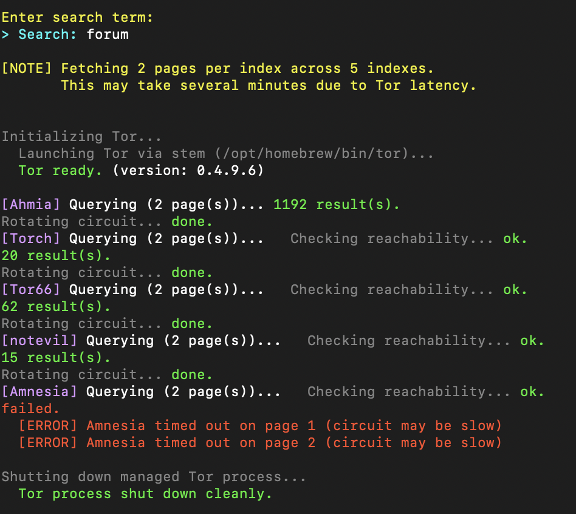
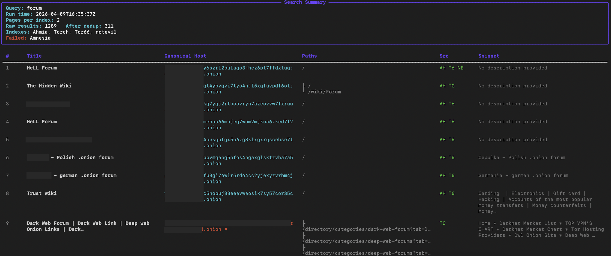
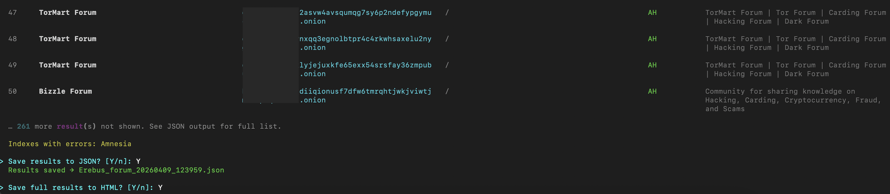
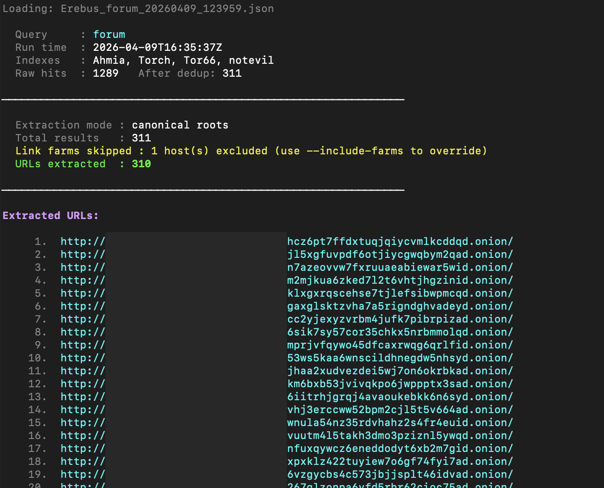
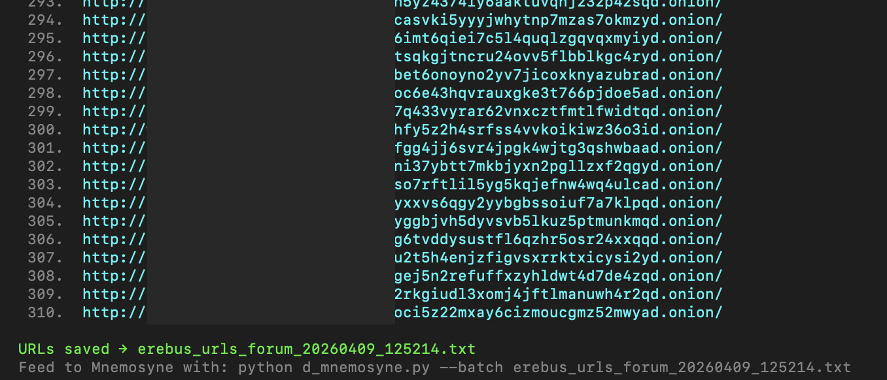
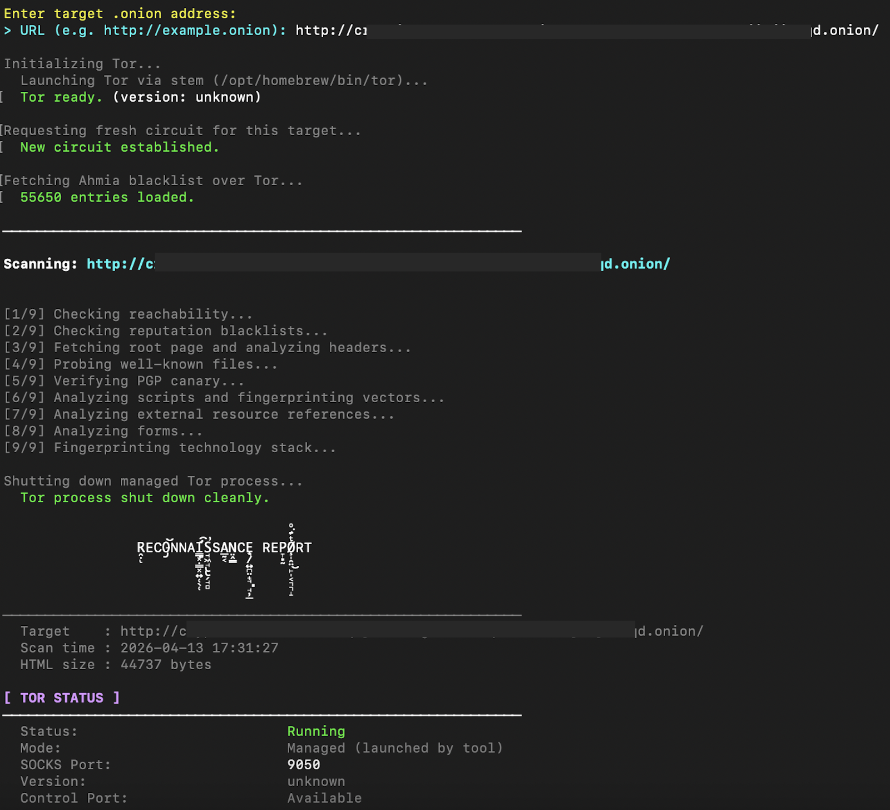
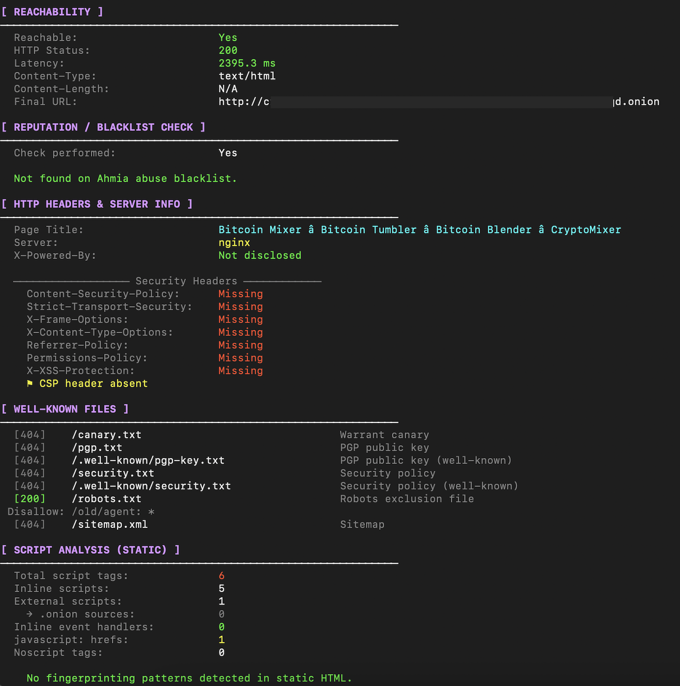
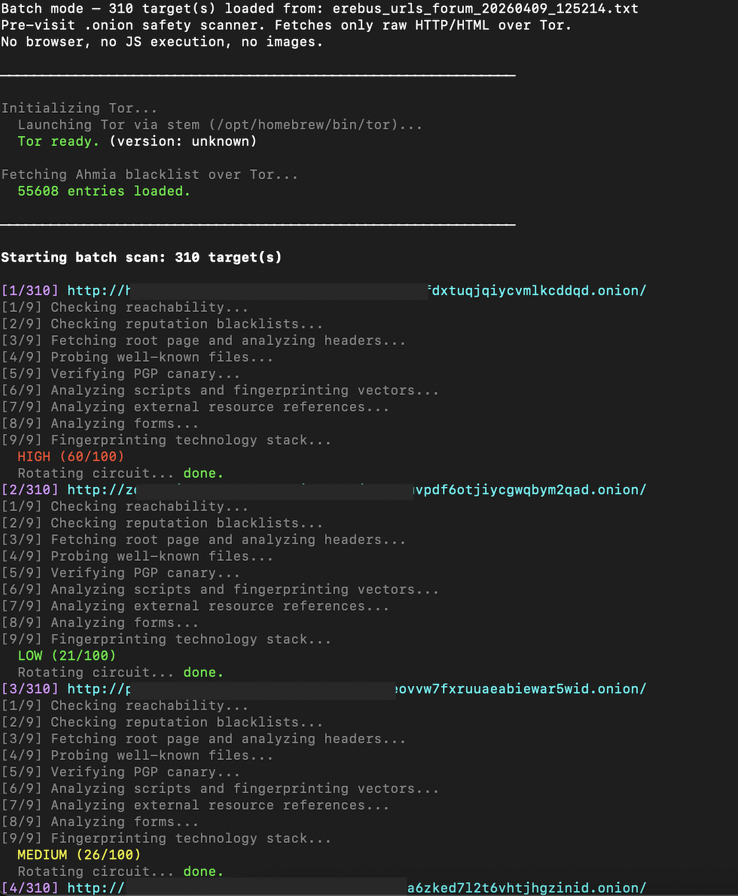
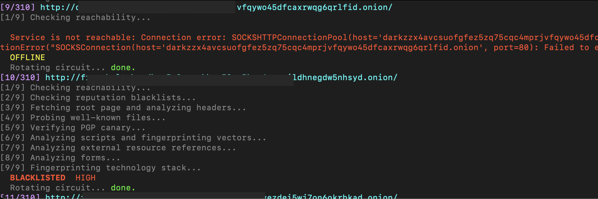

# Dark Web OSINT


## Table of Contents

- [Setup](#setup)
- [Erebus](#erebus-dark-web-search)
- [Hemera](#hemera-url-extractor)
- [Mnemosyne](#mnemosyne-onion-link-recon)
- [Other Tools](#other-possibly-helpful-tools)
---

#### Disclaimer
###### These tools are intended for authorized (where applicable) and ethical (always) use only.
###### You are responsible for ensuring your use complies with all applicable laws, regulations, etc.
###### Code is just words.
###### Running executable code that makes requests over the internet is not just words.
###### Please assume all requests made are traceable back to you, unless you have taken stringent OPSEC measures (doubtful)
###### Please note that the author (I) does (do) **not** assume liability for any misuse.
---
## Setup
---
#### Many Assumptions are made
- Have a recent version of Python installed on your system
- Have Tor binary installed on your system
- Have GnuPG (gpg) installed on your system (for pgp signature validation, not strictly necessary)
- For Erebus: have a VPN / VPS tunnel to anonymous server, connect before searching
---

#### Pipeline (if desired)

##### Erebus → Hemera → Mnemosyne
##### Example flow:

```bash
python d_erebus.py --pages 5 --save-j
python d_hemera.py Erebus_<query>_<timestamp>.json
python d_mnemosyne.py --batch erebus_urls_<query>_<timestamp>.txt --save
```

---


## Erebus Dark Web Search

#### Aggregates results across multiple .onion search indexes for a given search term.
#### All requests routed through Tor. No clearnet requests are made at any point.
---

### Requirements
```
pip install 'requests[socks]' stem beautifulsoup4 rich
```

#### System dependencies:
- **Tor binary** — `brew install tor` (macOS) or `sudo apt install tor` (Debian/Ubuntu)

---

### Usage
```bash
python d_erebus.py
python d_erebus.py --pages <N> # pages to fetch per index (1-10, default 1, more = slower)
python d_erebus.py --save-j # save all results to JSON 
python d_erebus.py --save-h # save all results to HTML (rich table)
python d_erebus.py --no-save # skip all save prompts
python d_erebus.py --debug # verbose error output and raw HTML previews
```

---

### Search Indexes

| Index | Type | Reliability (1(worst)-10(best)) |
|-------|------|-----------|
| Ahmia | Structured, large index | 10  |
| Torch | Classic Tor search engine | 1.5 |
| Tor66 | Broad dark web index | 8 |
| notevil | Supplementary index | 4 |
| Amnesia | Supplementary index | 9 |

Each index fails gracefully with an informative error if unreachable, without affecting the others.  
Update the .onion links in `d_erebus.py` if they fail.

---

### How It Works

1. **Tor management** — Detects existing daemon on `127.0.0.1:9050` or launches a managed process. Waits for full bootstrap before any requests.

2. **Circuit rotation** — requests a fresh `NEWNYM` circuit between each index query so each search engine sees a different Tor identity.

3. **Reachability check** — probes each index before attempting to scrape. Unreachable indexes are skipped immediately with a clear error rather than timing out mid-scrape.

4. **All traffic over Tor** — `socks5h://` proxying throughout, DNS resolution inside Tor. No clearnet requests at any point.

5. **Deduplication** — results are grouped by canonical `.onion` host. The same host appearing at multiple paths across multiple indexes is collapsed into one entry with branched paths shown as a readable list. Known link farm addresses (configurable blocklist in `LINK_FARM_BLOCKLIST`) are flagged with `⚑` but not discarded.

6. **Output** — rich-formatted CLI table showing top 50 results, sorted by cross-index corroboration. Full result set can be saved to a timestamped JSON file.

---

### Output

- **CLI** — top 50 results shown in a rich table with title, canonical host, branched paths, source indexes, and snippet
- **JSON** — full result set saved as `Erebus_{query}_{timestamp}.json` in the current directory
- **HTML** — full result set saved as `Erebus_{query}_{timestamp}.html` in the current directory, rich-formatted table with color and full row display (requires `rich`)

---

### Screenshots

> Amnesia was experiencing issues causing it to be unreachable for this query




---

### Important Notes

- **Tor must be installed on the system. The tool will exit with a clear error message and install instructions if the binary is not found.**
- .onion search indexes go offline and change addresses frequently. If an index consistently fails, verify its current address and update `INDEXES` in the file.
- Pagination can significantly increase runtime.
- Add known link farm `.onion` hostnames to `LINK_FARM_BLOCKLIST` at the top of the file as you encounter them.
- Do not enter sensitive information as a search term. Search engines may (probably) log searches. See disclaimer above.
- Torch runs on CGI architecture. An apt description of CGI can be found on the closest thing to official CGI documentation that exists (https://www.w3.org/CGI/): "left here for historical purposes". But they use it and it fails constantly


---


## Hemera (URL Extractor)

#### Parses a d_erebus.py JSON output file and extracts all .onion URLs for batch scanning with d_mnemosyne.py.
#### Link-farm flagged hosts are excluded by default. Outputs a clean text file, one URL per line.
---

### Requirements
No additional dependencies beyond the Python standard library.

---

### Usage
```bash
python d_hemera.py <Erebus_json>
python d_hemera.py <Erebus_json> --output <file> # custom output filename
python d_hemera.py <Erebus_json> --full-paths # emit every unique path per host, not just canonical roots
python d_hemera.py <Erebus_json> --include-farms # include link-farm flagged hosts (not recommended, see notes)
python d_hemera.py <Erebus_json> --no-save # print URLs to stdout only, skip file write
```

---

### How It Works

1. **JSON parsing** — loads and validates a `Erebus_*.json` file produced by `d_erebus.py`. Exits with a clear error if the file is missing, malformed, or not an Erebus output file.

2. **Deduplication** — in canonical root mode (default), only one URL per `.onion` host is emitted regardless of how many paths were seen. In `--full-paths` mode, every unique URL found across all paths is included, deduplicated by exact URL.

3. **Link farm filtering** — hosts flagged as link farms by Erebus are silently excluded by default. `--include-farms` overrides this with a printed warning, as these hosts produce low-signal results and waste significant scan time.

4. **Output** — prints the extracted list to the terminal with an index number per URL, then writes a timestamped `.txt` file ready to be passed directly to `d_mnemosyne.py --batch`.

---

### Output

- **CLI** — numbered list of extracted URLs with a summary showing total results, farms skipped, and URLs extracted
- **TXT** — URL list saved as `erebus_urls_{query}_{timestamp}.txt` in the current directory, one URL per line

---

### Screenshots


> Spacer to mitigate the awful misalignment



---

### Important Notes

- **Input must be a JSON file saved by `d_erebus.py`.** Other JSON files of different structure will be rejected.
- Canonical root mode (`http://host/`) is recommended for batch scanning — it avoids redundant scans of the same service at different paths.
- `--include-farms` is available but will likely inflate scan time significantly with low-value targets. Use it if you have a specific reason to.
- The output `.txt` file can be edited manually before passing to `d_mnemosyne.py` — remove any URLs you want to skip, add comments with `#`.


---


## Mnemosyne (.onion Link Recon)

#### Use before visiting .onion sites or services. Will analyze the address without any direct browser interaction.
#### Fetches only raw HTTP/HTML over a Tor circuit, no JavaScript execution, no image loading, no cookies.
#### Batch check URLs found with Erebus (but not before using Hemera!) or from a custom list.
---

### Requirements
```
pip install 'requests[socks]' stem beautifulsoup4 python-gnupg
```
> These are also in `requirements.txt`, can be installed with `pip install -r requirements.txt` after cloning repo

#### System dependencies:
- **Tor binary** — `brew install tor` (macOS) or `sudo apt install tor` (Debian/Ubuntu)
- **gpg binary** — required for PGP canary verification only (You should have this anyways if using Tor)

---

### Usage
```bash
python d_mnemosyne.py
python d_mnemosyne.py --save # If not passed you will be prompted to save after scan
python d_mnemosyne.py --debug # Prints more verbose error output
python d_mnemosyne.py --batch <url_list.txt> # Multiple link batch scan
```
---
**Exit codes** (scriptable) (might not be working properly atm):
- `0` — LOW risk
- `1` — MEDIUM risk
- `2` — HIGH risk
- `3` — CRITICAL risk

---

### How It Works

1. **Tor management** — uses `stem` to detect an existing Tor daemon on `127.0.0.1:9050`. If none is found, launches a managed Tor process from the system binary with a temporary data directory. Waits for full bootstrap before proceeding. Requests a fresh circuit via `NEWNYM` before each scan. The managed process is killed cleanly on exit (or will inform otherwise).

2. **All traffic routed through Tor** — the `requests` session uses `socks5h://` proxying, meaning hostname resolution happens inside Tor. This means the .onion address never touches your network directly.

3. **Reputation check** — fetches the Ahmia abuse blacklist over Tor at startup. The target host is hashed and compared against the list, will inform of known addresses flagged for abusive or illegal content.

4. **Static HTML analysis only** — the root page is fetched once and parsed with BeautifulSoup. No JavaScript is executed. Checks performed on the static HTML include: script tag enumeration, external resource leak detection, inline event handler counting, form analysis, and fingerprinting vector pattern matches (WebRTC, canvas, AudioContext, ...).

5. **Well-known file probing** — fetches `/canary.txt`, `/pgp.txt`, `/.well-known/pgp-key.txt`, `/security.txt`, `/robots.txt`, and `/sitemap.xml` over Tor.

6. **PGP canary verification** — if a clearsigned canary and a PGP public key are both found, verifies the signature using `gpg` in an isolated temporary keyring. Will flag fingerprint mismatches as potential key substitution attacks.

7. **Risk scoring** — weighted passive score (0–100) based on: clearnet redirects, external resource leaks, clearnet form actions, clearnet script sources, canary verification failures, missing security headers, fingerprinting vectors, and blacklist status.

8. **Batch Scan** - Reads .onion URLs from a text file (one per line), running a sequential scan of all targets over a single Tor session. Output is a grouped summary report. JSON (--save) produces a single consolidated file instead of per-target files. Generate the input file with: python d_erebus.py --save-j

---

### Screenshots

##### Single URL scan



##### If ran in batch mode (following pipeline or with custom .txt URL list)



> Some services will show unreachable, blacklisted addresses highlighted. 
> For reference this batch scan of 310 URLs took around 45 minutes

###### Groups output by blacklist status, reachability, deanonymization risk

---

### Important Notes

- **Tor must be installed on the system. The tool will exit with a clear error message and install instructions if the binary is not found.**
- Self-signed certs are common on .onion services and aren't treated as a risk signal — TLS verification is disabled for .onion targets since the v3 address itself is a cryptographic identity.
- .onion services can be significantly slower than clearnet. The default request timeout is 40 seconds. Scans may take several minutes on slow hidden services.
- No browser is opened at any point, JavaScript is never executed, because of this the tool cannot assess dynamic behavior, only what is present in the static HTML response (this is usually still quite informative).
- `Accept-Encoding` is intentionally excluded from request headers to prevent compressed binary responses.
- well-known/ OMG guideline file scan probings are really only insightful if scanning root domain path e.g. / not /news

---


## Other (possibly) Helpful Tools

1. `pgp_verify.py`
- Authenticate PGP signatures (read comments in file) (or just try it out it's relatively self-explanatory)

[Back to top](#dark-web-osint)